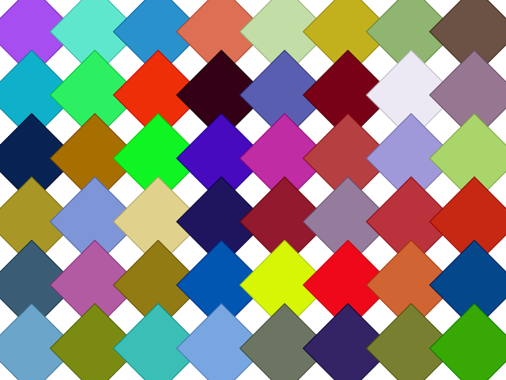
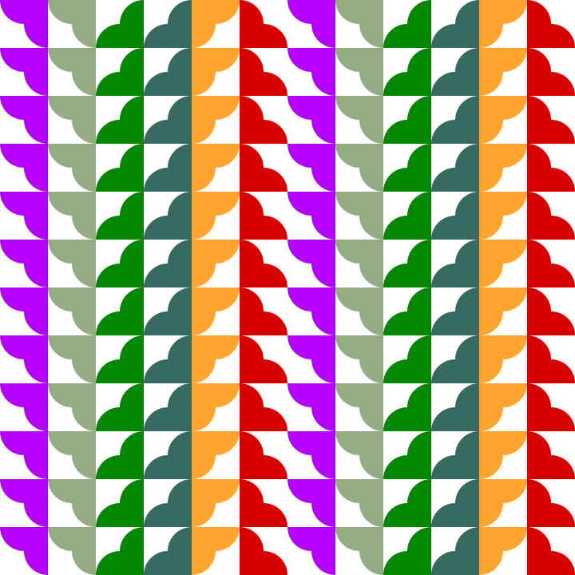

# easy-tiler

**easy-tiler** is a Python library for creating images of patterns made of tiles on a grid. It leverages [Pycairo](https://pycairo.readthedocs.io/) to produce high-quality PNG and SVG outputs.

Whether you're looking to generate geometric art, architectural patterns, or simple tiling textures, `easy-tiler` provides a flexible API and CLI to configure tile shapes, colors, and grid geometry.

## Examples

### Polygon Tiles

```python
from easy_tiler.io import save_png, save_svg
from easy_tiler.factories import make_tile_factory
from easy_tiler.grid import Grid

# Define a 8x6 grid with 80x80px cells
grid = Grid(8, 6, x_size=80, y_size=80)

# Create a factory for polygon tiles (default is a square)
factory = make_tile_factory(
    tile_type='polygon', secondary_color='white', primary_color='random', sides=4, gridlines=False
)

# Save as PNG and SVG
save_png('output.png', grid, factory)
save_svg('output.svg', grid, factory)
```

This would produce an image of 8x6 squares with random colors, similar to the image below.



### Sequence of Tiles

Use `make_sequence_factory` to repeat a sequence of tile rotations across each row. The
foreground and background colors can also be selected from a palette for each position in
the sequence.

```python
from easy_tiler.factories import make_sequence_factory
from easy_tiler.grid import Grid
from easy_tiler.io import save_png, save_svg

# Define a 12x10 grid with 60x60px cells
grid = Grid(12, 10, x_size=60, y_size=60)

# Repeat four Riley tile rotations with palette-based colors
factory = make_sequence_factory(
    tile_type='riley',
    tile_sequence=[2, 2, 3, 3, 1, 0],
    primary_color='sequence',
    secondary_color='roll',
    palette='ColorsOfTheWind',
)

save_png('sequence_demo.png', grid, factory)
save_svg('sequence_demo.svg', grid, factory)
```

Here, `tile_sequence` controls the repeating rotation pattern, while `primary_color='sequence'` and
`secondary_color='roll'` vary the tile colors across the sequence. This would produce an images similar this
one:



## Key Features

- **Multiple Tile Types**: Support for regular polygons (triangles, squares, etc.), Truchet tiles, Riley tiles, and Puck (circle-based) tiles.
- **Configurable Grids**: Define grid size, cell size, and origin.
- **Advanced Geometry**: Apply skew angles (shear) and shifts to create dynamic and complex tiling patterns.
- **Pycairo Backend**: High-performance rendering with support for transparency and vector/raster export.
- **CLI Tool**: Render configured PNG and SVG patterns from YAML.

## Installation

`easy-tiler` requires Python 3.13 or higher.

### Using `uv` (Recommended)

If you use [uv](https://github.com/astral-sh/uv), you can install the dependencies and the tool directly:

```bash
uv sync
```

### Manual Installation

You can install the dependencies manually using pip:

```bash
pip install pycairo pillow numpy
```

## Quick Start

### Python API

Here is a simple example to render a grid of squares:

```python
from easy_tiler.io import save_png, save_svg
from easy_tiler.factories import make_tile_factory
from easy_tiler.grid import Grid

# Define a 10x10 grid with 80x80px cells
grid = Grid(10, 10, x_size=80, y_size=80)

# Create a factory for polygon tiles (default is a square)
factory = make_tile_factory(
    tile_type='polygon', secondary_color='white', primary_color='black', sides=4, gridlines=False
)

# Save as PNG and SVG
save_png('output.png', grid, factory)
save_svg('output.svg', grid, factory)
```

### CLI Usage

Create a YAML file with grid, factory, and output settings:

```yaml
grid:
  width: 8
  height: 6
  x_size: 80
  y_size: 80

factory:
  type: tile # tile, sequence, node, or form
  tile_type: circle
  primary_color: [blue, red, green, brown]
  secondary_color: white
  radius: 0.3
  stroke: true
  stroke_color: black
  palette: FridaKahlo
  num_colors: 5

output:
  path: images/circle-pattern # output basename, relative to this YAML file
  formats: [png, svg] # either, or both
  scale: 1
  background_col: white
```

Run the installed command with the config path:

```bash
easy-tiler pattern.yaml
```

The output section's `formats` defaults to `[png, svg]`. The selected formats are
written with matching extensions; `output.path` is a basename, and its parent
directory is created if needed. Paths that are not absolute are resolved relative
to the YAML file. Output settings also accept `scale` and `background_col`.

The `factory.type` setting selects `make_tile_factory`, `make_sequence_factory`,
`make_node_factory`, or `make_form_factory`. Their remaining options are passed
to the corresponding factory; factory-specific options include `tile_sequence`,
`node_sequence`, `a`, `b`, `c`, `rotation_mod`, and `color_mod`. Tile shape
options such as `radius`, `side_length`, `sides`, and `arrow_width`, along with
color options such as `primary_color`, `secondary_color`, `palette`, `stroke`,
and `stroke_color`, can be configured as shown above. A node sequence is written
as a 2D YAML list.

## Development

- **Build system**: Uses `uv_build`.
- **Linting & Formatting**: Uses `Ruff`.
- **Testing**: Uses `pytest`.

To run tests:

```bash
pytest
```

## License

This project is authored by Joseph Barraud. See `pyproject.toml` for metadata.
